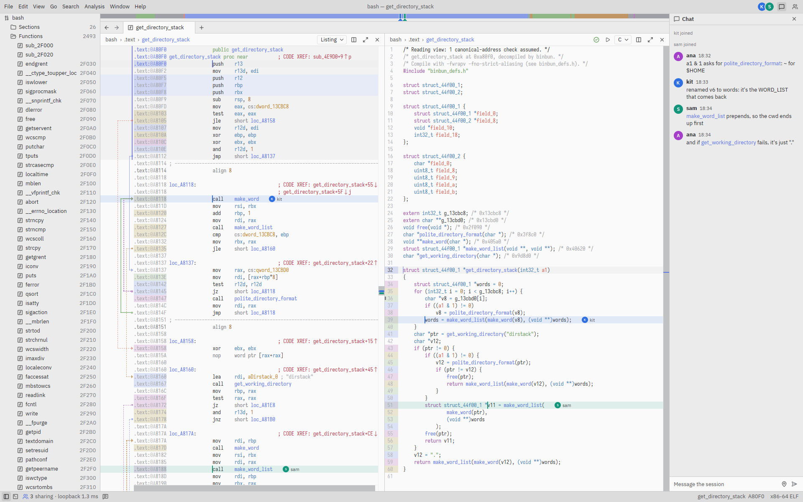
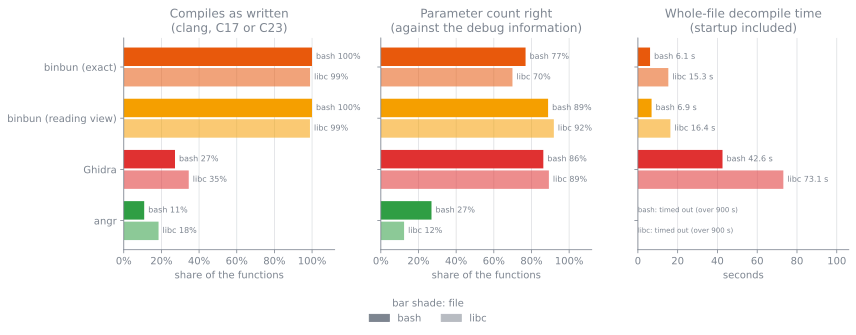
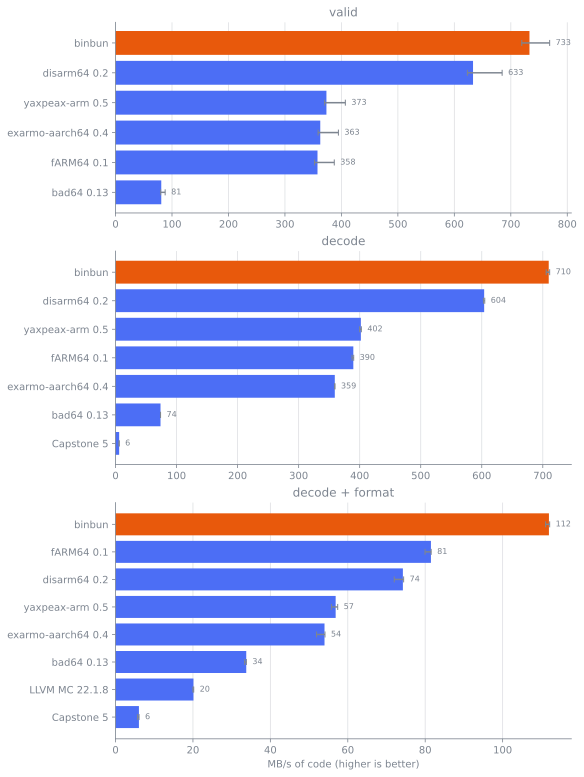
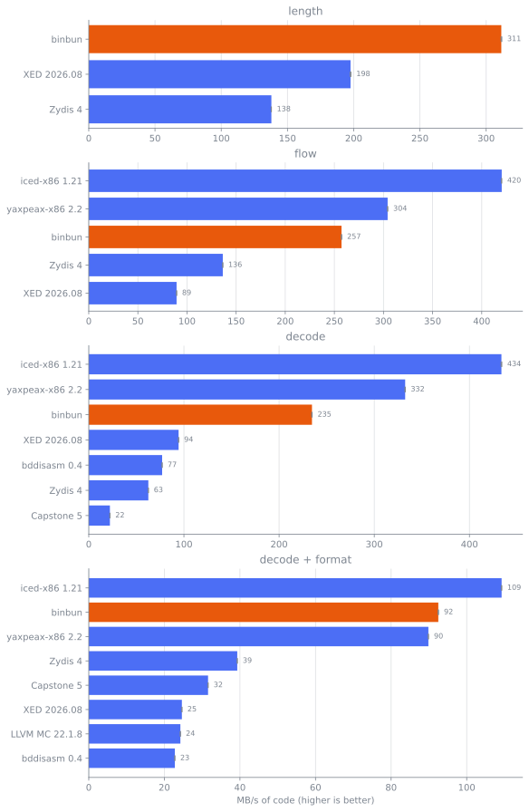

# binbun


[](#license)
[](https://github.com/dmaivel/binbun/actions/workflows/ci.yml)
[](https://pypi.org/project/binbun/)
[](https://crates.io/crates/binbun)

An open-source disassembler and decompiler for x86 and AArch64, built as reusable libraries for Rust, Python, C and C++.

- Disassemble x86 and AArch64 from ELF, PE and Mach-O; [decompile](https://binbun.org/docs/decompiler/) x86-64 and AArch64 to C.
- Trace each line of C to its instructions; `why` shows the evidence for a type or name.
- Run [`verify`](https://binbun.org/docs/verify/) to see where a function's decompiled form and its machine code disagree.
- [Share](https://binbun.org/docs/collaboration/) an end-to-end encrypted project, discuss code at an address and undo your own edits.
- Bring your own [agent](https://binbun.org/docs/agents/): in your window or headlessly, through [Python](https://binbun.org/docs/python/) or over MCP.

**[Download](https://binbun.org/download)** · [Docs](https://binbun.org/docs/) · [Python API](https://binbun.org/docs/reference/python/) · [Discussions](https://github.com/dmaivel/binbun/discussions)

<picture>
  <source media="(prefers-color-scheme: dark)" srcset="site/static/assets/preview/one-dark.webp">
  
</picture>

> [!WARNING]
> binbun is in preview. Expect breaking changes to its APIs, project files and output.

## Install

Download the app for macOS, Windows or Linux from [binbun.org](https://binbun.org/download), or on Linux and macOS:

```sh
curl -fsSL https://binbun.org/install.sh | sh
```

As libraries:

```sh
pip install binbun          # Python: the whole engine
cargo add binbun            # Rust: the engine
cargo add binbun-session    # Rust: the engine with background analysis, projects and undoable edits
cargo add binbun-disasm     # Rust: the disassemblers, x86 and AArch64
```

For C and C++, `libbinbun` (the decoders, so far) and its headers are in every [release](https://github.com/dmaivel/binbun/releases).

## Agents

binbun lets you bring your own harness: it includes no model and needs no AI account. An agent can:

- **work headless** with the Python package, the same API as your scripts;
- **work in your window** (`binbun.connect(agent="Codex")`) as a participant with its own avatar and cursor, each of its edits its own undo step;
- **use binbun as tools** through `binbun mcp`, if its harness only calls tools;
- **check its claims:** `verify` tests a function's C against its machine code, and `why` says why each variable has its type and name;
- **propose rather than edit:** a suggestion with its rationale and evidence, for someone to accept or dismiss, or a thread at the address it is about.

Setup for each harness is in [Agents](https://binbun.org/docs/agents/), or in the app under **File › Connect an Agent…**.

## Benchmarks

<details>
<summary>Decompilation against Ghidra and angr</summary>
<br>

DecompileBench's compile test on stripped Debian bash and glibc's libc, each tool given a copy it cannot find the debug file for: the share of functions whose C compiles unmodified with the tool's own declarations, the share whose parameter count matches the debug information, and the wall-clock time to decompile the whole file, startup included. Details, the other prototype and structure scores, and where binbun loses: [bench/results/decompile.md](bench/results/decompile.md).



</details>

<details>
<summary>AArch64 decoding</summary>
<br>

A linear sweep of Debian arm64 libc, libstdc++, libcrypto and bash. Details: [bench/results/README.md](bench/results/README.md).



</details>

<details>
<summary>x86-64 decoding</summary>
<br>

A linear sweep of libc and libcrypto. binbun's decoder gives XED's full answer (instruction form, implicit operands, XED's error rules), more than the others compute. Details: [bench/results/README.md](bench/results/README.md).



</details>

## Documentation

- [Getting started](https://binbun.org/docs/getting-started/)
- [Switching from other tools](https://binbun.org/docs/switching/)
- [The decompiler](https://binbun.org/docs/decompiler/) and [verify](https://binbun.org/docs/verify/)
- [Collaboration](https://binbun.org/docs/collaboration/)
- [Python and agents](https://binbun.org/docs/python/)
- [The command line](https://binbun.org/docs/command-line/)

## Building from source

binbun builds with the Rust toolchain pinned in `rust-toolchain.toml`. The app is built on [GPUI](https://www.gpui.rs) and needs its platform libraries on Linux:

```sh
# Debian, Ubuntu
sudo apt install build-essential pkg-config libfontconfig-dev libxcb1-dev libxkbcommon-dev libxkbcommon-x11-dev
# Fedora
sudo dnf install gcc pkgconf-pkg-config fontconfig-devel libxcb-devel libxkbcommon-devel libxkbcommon-x11-devel
# Arch
sudo pacman -S base-devel fontconfig libxcb libxkbcommon libxkbcommon-x11
```

```sh
git clone https://github.com/dmaivel/binbun && cd binbun
(cd gui && cargo build --release)    # the app and every command: gui/target/release/binbun
cargo build --release -p binbun-cli  # the commands without the app: target/release/binbun
maturin build --release              # the Python package: target/wheels
```

How to test a change, the oracles and the benchmarks are in [docs/](docs/). To contribute, see [CONTRIBUTING.md](CONTRIBUTING.md); to report a security problem privately, [SECURITY.md](SECURITY.md).

## License

MIT or Apache-2.0, at your option ([LICENSE-MIT](LICENSE-MIT), [LICENSE-APACHE](LICENSE-APACHE)). `third_party/xed` and the files generated from it are Apache-2.0; `third_party/aarchmrs` and the files generated from it are BSD-3-Clause (Arm).
