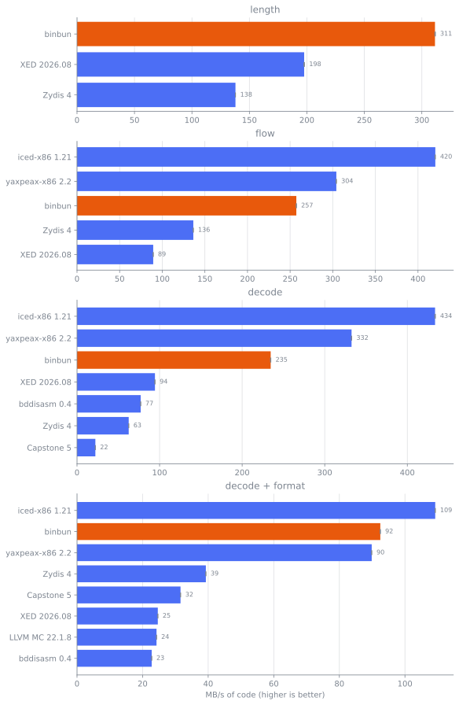
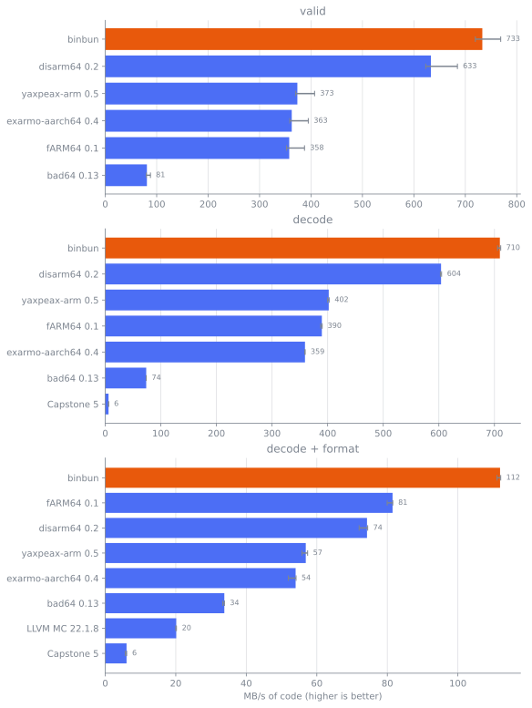

# x86-64 decoder throughput

CPU: Intel(R) Core(TM) i9-14900F  
Corpus (5398489 bytes of code):

- `/usr/lib/libc.so.6`: 1548585 bytes
- `/usr/lib/libcrypto.so.3`: 3849904 bytes

Each decoder linearly sweeps the corpus, skipping one byte where nothing decodes. Values are the median of 20 timed samples, taken one per decoder per round; the whiskers and the CI column give the 95% confidence interval for the median (order statistics). The interval covers noise within this run only.

## length

| Decoder | MB/s | 95% CI | M instructions/s | Instructions | Skipped bytes | How |
|---|---:|---:|---:|---:|---:|---|
| binbun | 311 | 311–312 | 70.6 | 1223922 | 1 | decode_length |
| XED 2026.08 | 198 | 197–198 | 44.8 | 1223922 | 1 | xed_ild_decode |
| Zydis 4 | 138 | 138–138 | 31.3 | 1223899 | 28 | minimal mode, no operands |

## flow

| Decoder | MB/s | 95% CI | M instructions/s | Instructions | Skipped bytes | How |
|---|---:|---:|---:|---:|---:|---|
| iced-x86 1.21 | 420 | 420–420 | 95.3 | 1223899 | 28 | decode_out + flow_control + near_branch_target |
| yaxpeax-x86 2.2 | 304 | 304–304 | 69.6 | 1235119 | 6390 | decode_into + flow class of the opcode + relative target |
| binbun | 257 | 257–257 | 58.3 | 1223900 | 27 | decode_flow (length, flow, target, RIP-relative address) |
| Zydis 4 | 136 | 136–137 | 30.9 | 1223899 | 28 | minimal mode + branch type, category, relative target |
| XED 2026.08 | 89 | 89–89 | 20.3 | 1223900 | 27 | xed_decode + category + branch displacement |

## decode

| Decoder | MB/s | 95% CI | M instructions/s | Instructions | Skipped bytes | How |
|---|---:|---:|---:|---:|---:|---|
| iced-x86 1.21 | 434 | 433–434 | 98.3 | 1223899 | 28 | Decoder::decode_out |
| yaxpeax-x86 2.2 | 332 | 332–333 | 76.1 | 1235119 | 6390 | InstDecoder::decode_into |
| binbun | 235 | 234–235 | 53.2 | 1223900 | 27 | decode (operand values decoded; `Operand` structs built on demand) |
| XED 2026.08 | 94 | 94–94 | 21.4 | 1223900 | 27 | xed_decode |
| bddisasm 0.4 | 77 | 77–77 | 17.5 | 1223900 | 27 | DecodedInstruction::decode_with_ip |
| Zydis 4 | 63 | 63–63 | 14.2 | 1223899 | 28 | all operands |
| Capstone 5 | 22 | 22–22 | 5.0 | 1225401 | 967 | detail on (formats text too) |

## decode + format

| Decoder | MB/s | 95% CI | M instructions/s | Instructions | Skipped bytes | How |
|---|---:|---:|---:|---:|---:|---|
| iced-x86 1.21 | 109 | 109–109 | 24.8 | 1223899 | 28 | decode_out + IntelFormatter |
| binbun | 92 | 92–93 | 21.0 | 1223900 | 27 | decode + intel (XED's Intel syntax) |
| yaxpeax-x86 2.2 | 90 | 90–90 | 20.6 | 1235119 | 6390 | decode_into + Intel display |
| Zydis 4 | 39 | 39–39 | 8.9 | 1223899 | 28 | visible operands + Intel formatter |
| Capstone 5 | 32 | 32–32 | 7.2 | 1225401 | 967 | detail off |
| XED 2026.08 | 25 | 25–25 | 5.6 | 1223900 | 27 | xed_decode + xed_format_context |
| LLVM MC 22.1.8 | 24 | 24–24 | 5.5 | 1224546 | 30 | LLVMDisasmInstruction (C API always prints) |
| bddisasm 0.4 | 23 | 23–23 | 5.2 | 1223900 | 27 | decode + NdToText (Display) |

# AArch64 decoder throughput

CPU: Intel(R) Core(TM) i9-14900F (decoding AArch64 code)  
Corpus (6171740 bytes of code):

- `~/.cache/binbun-arm64/corpus/elf/libc6/libc.so.6`: 1203348 bytes
- `~/.cache/binbun-arm64/corpus/elf/libstdc++6/libstdc++.so.6.0.33`: 1194416 bytes
- `~/.cache/binbun-arm64/corpus/elf/libssl3t64/libcrypto.so.3`: 2920568 bytes
- `~/.cache/binbun-arm64/corpus/elf/bash/bash`: 853408 bytes

Each decoder linearly sweeps the corpus, skipping the 4-byte word where nothing decodes. Values are the median of 20 timed samples, taken one per decoder per round; the whiskers and the CI column give the 95% confidence interval for the median (order statistics). The interval covers noise within this run only.

## valid

| Decoder | MB/s | 95% CI | M instructions/s | Instructions | Invalid words | How |
|---|---:|---:|---:|---:|---:|---|
| binbun | 733 | 719–769 | 183.3 | 1542865 | 70 | decode(..).is_ok() |
| disarm64 0.2 | 633 | 623–685 | 158.3 | 1542871 | 64 | decoder::decode(..).is_some() |
| yaxpeax-arm 0.5 | 373 | 370–407 | 93.3 | 1541397 | 1538 | InstDecoder::decode_into(..).is_ok() |
| exarmo-aarch64 0.4 | 363 | 359–395 | 90.6 | 1542867 | 68 | decode_word(..).is_ok() |
| fARM64 0.1 | 358 | 352–387 | 89.4 | 1542867 | 68 | Decoder::decode_into, !is_invalid() |
| bad64 0.13 | 81 | 80–88 | 20.2 | 1542844 | 91 | decode(..).is_ok() |

## decode

| Decoder | MB/s | 95% CI | M instructions/s | Instructions | Invalid words | How |
|---|---:|---:|---:|---:|---:|---|
| binbun | 710 | 706–711 | 177.4 | 1542865 | 70 | decode (the encoding, with every UNDEFINED check; `operands()` built on demand) |
| disarm64 0.2 | 604 | 603–605 | 151.0 | 1542871 | 64 | decoder::decode (identifies the opcode only; operand fields extracted when formatting) |
| yaxpeax-arm 0.5 | 402 | 400–403 | 100.4 | 1541397 | 1538 | InstDecoder::decode_into (no SVE/SME) |
| fARM64 0.1 | 390 | 387–390 | 97.4 | 1542867 | 68 | Decoder::decode_into (all operands) |
| exarmo-aarch64 0.4 | 359 | 359–360 | 89.8 | 1542867 | 68 | decode_word (an enum of encodings holding their fields; `operands()` built on demand) |
| bad64 0.13 | 74 | 74–74 | 18.4 | 1542844 | 91 | decode (the C decoder fills in every operand) |
| Capstone 5 | 6 | 6–6 | 1.5 | 1542862 | 73 | detail on (formats text too) |

## decode + format

| Decoder | MB/s | 95% CI | M instructions/s | Instructions | Invalid words | How |
|---|---:|---:|---:|---:|---:|---|
| binbun | 112 | 111–112 | 28.0 | 1542865 | 70 | decode + Display of display(address) |
| fARM64 0.1 | 81 | 80–82 | 20.4 | 1542867 | 68 | decode_into + FmtFormatter into a buffer |
| disarm64 0.2 | 74 | 72–74 | 18.6 | 1542871 | 64 | decode + display_at(address) (no aliases) |
| yaxpeax-arm 0.5 | 57 | 56–57 | 14.2 | 1541397 | 1538 | decode_into + Display (PC-relative targets) |
| exarmo-aarch64 0.4 | 54 | 52–54 | 13.5 | 1542867 | 68 | decode_word + Display of at(address) |
| bad64 0.13 | 34 | 33–34 | 8.4 | 1542844 | 91 | decode + Display |
| LLVM MC 22.1.8 | 20 | 20–20 | 5.0 | 1542865 | 70 | LLVMDisasmInstruction (C API always prints) |
| Capstone 5 | 6 | 6–6 | 1.5 | 1542862 | 73 | detail off |

## Larger corpus

The same benchmark over 141397128 bytes of code (`full/decode-aarch64.json`):

- `~/.cache/binbun-arm64/corpus/elf/libc6/libc.so.6`: 1203348 bytes
- `~/.cache/binbun-arm64/corpus/elf/libstdc++6/libstdc++.so.6.0.33`: 1194416 bytes
- `~/.cache/binbun-arm64/corpus/elf/libssl3t64/libcrypto.so.3`: 2920568 bytes
- `~/.cache/binbun-arm64/corpus/elf/bash/bash`: 853408 bytes
- `~/.cache/binbun-arm64/corpus/elf/libllvm19/libLLVM.so.19.1`: 54673416 bytes
- `~/.cache/binbun-arm64/corpus/elf/hugo/hugo`: 28403996 bytes
- `~/.cache/binbun-arm64/corpus/elf/libopenblas0-pthread/libopenblasp-r0.3.29.so`: 17020932 bytes
- `~/.cache/binbun-arm64/corpus/pe/node/node.exe`: 35127044 bytes

`cargo run --release -- --out results/full ~/.cache/binbun-arm64/corpus/elf/libc6/libc.so.6 ~/.cache/binbun-arm64/corpus/elf/libstdc++6/libstdc++.so.6.0.33 ~/.cache/binbun-arm64/corpus/elf/libssl3t64/libcrypto.so.3 ~/.cache/binbun-arm64/corpus/elf/bash/bash ~/.cache/binbun-arm64/corpus/elf/libllvm19/libLLVM.so.19.1 ~/.cache/binbun-arm64/corpus/elf/hugo/hugo ~/.cache/binbun-arm64/corpus/elf/libopenblas0-pthread/libopenblasp-r0.3.29.so ~/.cache/binbun-arm64/corpus/pe/node/node.exe`

MB/s of code, median of 20 samples (95% CI):

| Decoder | valid | decode | decode + format |
|---|---:|---:|---:|
| disarm64 0.2 | 768 (765–769) | 667 (658–669) | 66 (64–68) |
| yaxpeax-arm 0.5 | 441 (440–442) | 436 (432–439) | 50 (49–51) |
| exarmo-aarch64 0.4 | 414 (413–415) | 373 (369–375) | 48 (47–49) |
| fARM64 0.1 | 398 (397–399) | 390 (387–392) | 77 (75–79) |
| bad64 0.13 | 94 (94–94) | 78 (77–79) | 30 (29–32) |
| Capstone 6.0.0-Alpha11 | — | 7 (6–7) | 8 (8–8) |
| Capstone 5 | — | 6 (6–6) | 6 (6–6) |
| LLVM MC 22.1.8 | — | — | 19 (18–19) |

# Decompilation

binbun against Ghidra and angr (recompiles, behaves the same, matches the source, speed): [decompile.md](decompile.md), reproduced with `bench/decompile/run.sh CORPUS_DIR`.
