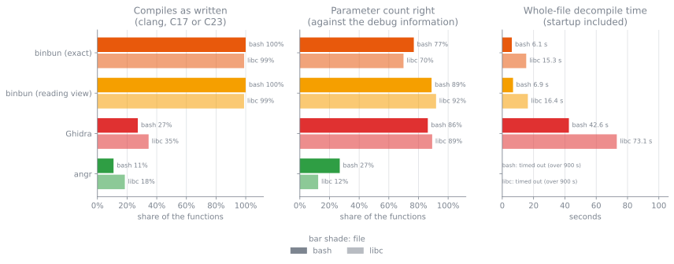

# Decompilation

CPU: Intel(R) Core(TM) i9-14900F; every tool pinned to 16 of its CPUs (`taskset -c 16-31`). Tools: binbun 0.0.0 (the `binbun` command, a release build, commit b8967e5), Ghidra 12.1.2, angr 10.0.5. Compilers: clang version 22.1.8; gcc (GCC) 16.2.1 20260810.

The method is DecompileBench's (Gao et al., [Findings of ACL 2025](https://aclanthology.org/2025.findings-acl.1194/)): does each function's C compile, and does the program still behave the same with the function replaced by its recompiled C; plus how its prototype and structure compare with the source, and how long a whole file takes. Its LLM-judged readability is left out. Its own harness and functions could not be used (see [Why not DecompileBench's own corpus](#why-not-decompilebenchs-own-corpus)), so the method runs on this corpus:

- bash: Debian 12's (5.2.15-2+b7, amd64; the binary of the README's picture), its `bash-dbgsym` debug file and its source with Debian's patches;
- libc: Arch's glibc 2.44+r50 `libc.so.6` (the gates' libc), its debug file and the source its debug package carries;

Every tool gets the same copy of each file, alone in a directory: `strip --strip-all --remove-section=.gnu_debuglink`, then its build ID zeroed in place (neither file as distributed has a symbol table). So no tool finds the debug file: Ghidra loads the one the link names and one the debuginfod client's cache has under the build ID; each tool's log was checked for it. angr's output is the published run's, made from the files as distributed: angr loads no debug information (`load_debug_info=False`), and the code is the same. The debug files and sources are read only to score. Functions are those the debug file states with code, matched to a tool's by entry address, except those of assembly compile units (412 of libc's, none of bash's), which state no prototype; a function a tool did not find or decompile counts against it everywhere.

Reproduce with `bench/decompile/run.sh CORPUS_DIR` (fetches the corpus, runs `cargo run --release --bin decompile -- quality`, `behaviour` and `speed`, then `python3 plot.py`).

## Recompiles

Functions whose C compiles, of those the debug file states. *As written*: the file the tool's own declarations make, with its header (see Method), unmodified, strictly (the compiler's default errors), as C17 (`-std=gnu17`, clang's default) or C23 (`-std=gnu23`, where `nullptr` is C but `f()` declares `f(void)`); *lenient*: DecompileBench's rule, C17 (failing files compiled again with `-Wno-X` for each `[-WX]` in the diagnostics); *libc headers*: the file after the C library's common headers, lenient; *DecompileBench*: DecompileBench's own `defs.h` for the tool before the function's text alone, lenient (it has none for binbun); *any*: one of these compiles.

### bash

2,256 functions stated by the debug file (82 of them compiler clones such as `.isra`/`.part`).

| Tool | Decompiled | As written (clang, C17) | As written (clang, C23) | As written (gcc, C17) | Lenient (clang) | libc headers | DecompileBench | Any |
|---|---:|---:|---:|---:|---:|---:|---:|---:|
| binbun (exact) | 100.0% | 100.0% | 100.0% | 100.0% | 100.0% | 61.0% | — | 100.0% |
| binbun (reading view) | 100.0% | 100.0% | 100.0% | 100.0% | 100.0% | 61.0% | — | 100.0% |
| Ghidra | 100.0% | 23.0% | 27.2% | 23.0% | 36.6% | 27.3% | 25.5% | 53.3% |
| angr | 100.0% | 10.9% | 10.9% | 11.0% | 67.1% | 67.0% | 67.1% | 68.3% |

Commonest reasons as written (clang, C17: its first error, quoted names left out; *no such function*: the tool found no function there):

| Tool | Reasons (functions) |
|---|---|
| binbun (exact) | not decompiled (1) |
| binbun (reading view) | not decompiled (1) |
| Ghidra | unknown type name '…' (329); use of undeclared identifier '…' (239); incompatible integer to pointer conversion passing '…' (aka '…') to parameter of type '…' (150); too few arguments to function call, single argument '…' was not specified (141); too many arguments to function call, expected 0, have 3 (94) |
| angr | call to undeclared function '…' (1,357); typedef redefinition with different types ('…' vs '…') (98); use of undeclared identifier '…' (70); incompatible integer to pointer conversion assigning to '…' from '…' (60); unknown type name '…' (59) |

### libc

3,393 functions stated by the debug file (83 of them compiler clones such as `.isra`/`.part`).

| Tool | Decompiled | As written (clang, C17) | As written (clang, C23) | As written (gcc, C17) | Lenient (clang) | libc headers | DecompileBench | Any |
|---|---:|---:|---:|---:|---:|---:|---:|---:|
| binbun (exact) | 98.9% | 98.9% | 98.9% | 98.9% | 98.9% | 62.9% | — | 98.9% |
| binbun (reading view) | 98.9% | 98.9% | 98.9% | 98.9% | 98.9% | 64.5% | — | 98.9% |
| Ghidra | 100.0% | 31.4% | 34.5% | 31.4% | 41.2% | 24.7% | 39.7% | 58.0% |
| angr | 69.4% | 18.5% | 18.4% | 18.7% | 40.9% | 33.9% | 40.9% | 40.9% |

Commonest reasons as written (clang, C17: its first error, quoted names left out; *no such function*: the tool found no function there):

| Tool | Reasons (functions) |
|---|---|
| binbun (exact) | not decompiled (36) |
| binbun (reading view) | not decompiled (36); expected '…', '…', '…', or '…' (2) |
| Ghidra | use of undeclared identifier '…' (421); brackets are not allowed here (352); unknown type name '…' (210); too few arguments to function call, at least argument '…' must be specified (136); incompatible pointer to integer conversion passing '…' to parameter of type '…' (aka '…') (113) |
| angr | no such function (1,038); call to undeclared function '…' (929); conflicting types for '…' (168); use of undeclared identifier '…' (120); use of undeclared label '…' (95) |

## Matches the source

Prototypes against the debug file (functions that are not compiler clones; a function a tool did not decompile counts as wrong): the parameter count; the return type and each parameter's type, *exact* when class (signed, unsigned, bool, float, pointer, struct, void) and width agree, *width* when the width does (Ghidra's `undefined8` for a `long` counts for width only). Structure on the functions every tool decompiled and whose source definition was found: the median ratio of declared locals to the debug file's (and the share of functions with as many, more, fewer), and of lines (with code, comments aside) to the source's; gotos per function; the deepest nesting of `if`, loops and `switch`.

### bash

Prototypes: 2,174 functions, 3,200 parameters. Structure (locals, lines, gotos, nesting) is not shown for binbun (exact), binbun (reading view), Ghidra and angr: it was compared on another run's common functions, not on these.

| Tool | Parameter count right | Too many | Too few | Return exact | Return width | Parameters exact | Parameters width | Locals ratio | Locals same | More | Fewer | Lines ratio | Gotos per function | Functions with gotos | Nesting |
|---|---:|---:|---:|---:|---:|---:|---:|---:|---:|---:|---:|---:|---:|---:|---:|
| binbun (exact) | 76.9% | 17.5% | 5.6% | 71.1% | 77.9% | 80.1% | 86.2% | — | — | — | — | — | — | — | — |
| binbun (reading view) | 88.8% | 1.9% | 9.2% | 71.0% | 77.9% | 81.2% | 87.4% | — | — | — | — | — | — | — | — |
| Ghidra | 86.3% | 1.0% | 12.5% | 50.4% | 63.8% | 49.5% | 83.7% | — | — | — | — | — | — | — | — |
| angr | 26.9% | 0.0% | 73.0% | 31.6% | 41.5% | 4.8% | 8.2% | — | — | — | — | — | — | — | — |

### libc

Prototypes: 3,310 functions, 7,898 parameters. Structure (locals, lines, gotos, nesting) is not shown for binbun (exact), binbun (reading view), Ghidra and angr: it was compared on another run's common functions, not on these.

| Tool | Parameter count right | Too many | Too few | Return exact | Return width | Parameters exact | Parameters width | Locals ratio | Locals same | More | Fewer | Lines ratio | Gotos per function | Functions with gotos | Nesting |
|---|---:|---:|---:|---:|---:|---:|---:|---:|---:|---:|---:|---:|---:|---:|---:|
| binbun (exact) | 69.9% | 26.9% | 2.2% | 73.4% | 82.7% | 79.9% | 92.5% | — | — | — | — | — | — | — | — |
| binbun (reading view) | 91.9% | 4.3% | 2.7% | 73.4% | 82.7% | 80.2% | 93.1% | — | — | — | — | — | — | — | — |
| Ghidra | 89.2% | 3.2% | 7.0% | 60.2% | 71.6% | 63.3% | 87.6% | — | — | — | — | — | — | — | — |
| angr | 12.4% | 0.3% | 56.8% | 19.8% | 27.1% | 3.4% | 6.4% | — | — | — | — | — | — | — | — |

## Speed

Wall-clock seconds to decompile the whole file, startup included; timeout 900 s.

| Tool | bash | libc |
|---|---:|---:|
| binbun (exact) | 6.1 | 15.3 |
| binbun (reading view) | 6.9 | 16.4 |
| Ghidra | 42.6 | 73.1 |
| angr | over 900 | over 900 |

## The commonest errors, examined

The first error (clang, C17) of every function that does not compile as written, grouped by the name or line it is at, on this run's output (Ghidra 12.1.2, angr 10.0.5); each is in the tool's own text:

- Ghidra, *unknown type name* and *use of undeclared identifier*: `bool` (bash 290, libc 249) and `true` (77, 91), which its export header does not define for C17 (C23 has them: its C23 column), and its type `pointer` (140, 62).
- Ghidra on libc, *brackets are not allowed here* (352): a 16-byte return value written as an array, `undefined1 [16] __lll_lock_wake_private(void);` (that prototype alone in 247 functions).
- angr on bash, *call to undeclared function* (1,357): angr's C declares its globals and structs but not the functions it calls; DecompileBench's rule turns the error off.

## Method

**Running the tools.** binbun runs as `binbun decompile FILE` (exact C) and `binbun decompile FILE --view reading`, every function in parallel. Ghidra runs in `analyzeHeadless` with `bench/decompile/ghidra/DecompileAll.java`, which does what File > Export Program > C/C++ does (its decompiler options and default timeout, its parallel decompiler, the same C) but keeps each function apart. angr runs `bench/decompile/angr_decompile.py`, set up as DecompileBench's angr runner (CFGFast with indirect jumps resolved and data references, CompleteCallingConventions with variables recovered, then `Decompiler` per function); for the quality scores it runs in 8 parallel shards with a 300 s limit per function, for speed in one process.

**Compiling.** Each function is one translation unit, piped unmodified to the compiler with `-std=gnu17 -O0 -fPIC -fwrapv -fno-strict-aliasing -fdiagnostics-color=never -c` (clang also with `-fno-spell-checking`, which changes no verdict but keeps clang from taking minutes on a few files; a 60 s limit per compile). *As written* is the file the tool's own declarations make, with its own header: binbun's file per function (its declarations, `#include "binbun_defs.h"`); for for Ghidra, the export header's items the function uses (its fake-type `#define`s, data types and prototypes), the globals it references (but functions, which the header declares), then the function; for angr, which has no header, DecompileBench's `fix/angr/defs.h`, then the function (whose text declares its globals and structs). The items are found by reading a tool's declarations one at a time with tree-sitter; one that is no C (Ghidra's `undefined1 [16] f(void);`) is kept whole, for the functions that use the name it declares. *DecompileBench* is that benchmark's own setting (`evaluate_rsr.py`): its `fix/TOOL/defs.h` included before the function's text alone, compiled under its lenient rule; DecompileBench's per-function source prologue (the original's declarations, from `clang-extract`) has no counterpart here, and its fix-up scripts (`fix/TOOL/__init__.py`) are not applied, the C being taken unmodified. Its headers are fetched at commit 761c651 by `corpus.sh`, not vendored: the repository states no licence.

**Not run in this round:** the behaviour test (`decompile behaviour`, DecompileBench's runtime test on bash's test suite, `bench/decompile/substitute.c`), angr's whole-file timing on libc, and the speed run on a PE (`decompile speed`).

**Matches the source.** Prototypes and locals come from the debug file (DWARF, read by `binbun-debuginfo`), types compared by class and width (typedefs and enums looked through; a pointer is a pointer whatever it points to). The C of every tool and the source are read by tree-sitter's C grammar, which reads C a compiler rejects. Compiler clones (`.isra`, `.part`, `.constprop` symbols) are left out of the prototype scores: their interface is not the source's.

**Speed.** Wall-clock seconds for the whole file, startup included, each tool as it runs by default, all pinned to the same 16 CPUs: binbun decompiles on 16 threads (one per CPU it may use); Ghidra's analysis and its parallel decompiler use up to 16 threads; angr runs in one Python process (one thread). So the times compare tools as shipped, not per CPU.

## Why not DecompileBench's own corpus

DecompileBench's code is public ([vul337/DecompileBench](https://github.com/vul337/DecompileBench), commit 761c651, October 2025) but states no licence, so it may be read but not reused or redistributed. Its dataset (23,400 functions from 130 OSS-Fuzz projects) is not published: the request to release it ([issue 1](https://github.com/vul337/DecompileBench/issues/1), May 2025) is open, and its README notes that rebuilding it gives different functions, as the fuzzers' build scripts take each project's latest commit. Rebuilding it needs Docker images from the authors' server and OSS-Fuzz builds of the 130 projects (far beyond the disk this benchmark may use). Its method is applied to this corpus instead, with its headers and compile rule where they apply.

## Fairness and limits

- *As written* is binbun's design goal and not the others': binbun prints a file per function that declares what it uses, Ghidra prints declarations for a whole program that are taken here per function, and angr prints none for callees. The *libc headers* and *DecompileBench* columns give the others the headers they assume.
- The libc headers setting conflicts with binbun's own declarations of the C library's functions (its types are the binary's, not the headers'), so binbun gains nothing there.
- binbun's whole-file time runs on 16 CPUs, angr's on one; Ghidra's decompiler runs in parallel too.
- binbun's exact C and reading view are counted as separate rows; the reading view hides checks under stated assumptions.
- The first version of this page (binbun 49fc7f4) was scored with two errors, both fixed since and applied to every tool: binbun's `BINBUN_SYMBOL` annotations made the parser take some declarations for the next function's definition (186 of bash's functions, 76 of libc's), and libc's 412 assembly functions were scored as taking no parameters. Both lowered binbun's scores, most its libc parameter counts.
- The second version (binbun 9293b9c) gave the tools libc with its `.gnu_debuglink` and build ID, beside its debug file: Ghidra analysed it with the DWARF the scores are made from (its log says so), and its libc parameter count right was 98.7%. Since this run every tool gets a copy it cannot find a debug file for. Three faults of the scorer, which without DWARF cost the other tools functions that compile, were fixed in this run too: a line of a tool's declarations that is no C was given to functions that do not use it, or hid the lines after it; and Ghidra's globals declared a function whose address is taken as data.

## Where binbun loses

Every score above where another tool does better than binbun's exact C (for the ratios: is nearer 1; the lines and locals ratios are a description, not a goal):

- bash: decompiled: Ghidra 100.0%, binbun 100.0%.
- bash: decompiled: angr 100.0%, binbun 100.0%.
- bash: parameter count right: Ghidra 86.3%, binbun 76.9%.
- bash: gotos per function, lines and locals per source line: not compared (binbun's results are from a run of binbun alone; see the table).
- libc: decompiled: Ghidra 100.0%, binbun 98.9%.
- libc: parameter count right: Ghidra 89.2%, binbun 69.9%.
- libc: gotos per function, lines and locals per source line: not compared (binbun's results are from a run of binbun alone; see the table).
